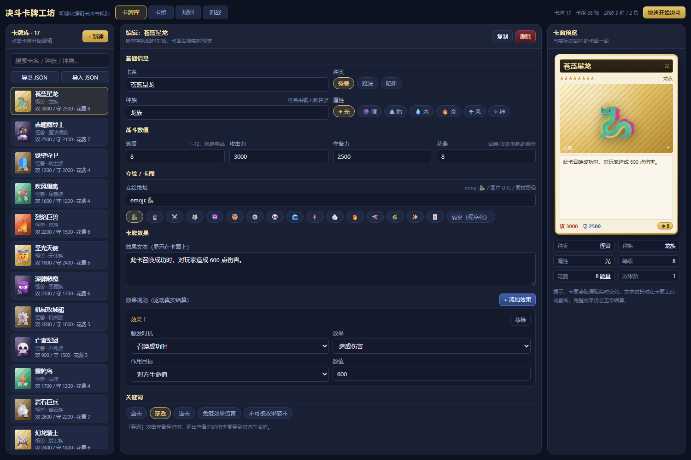
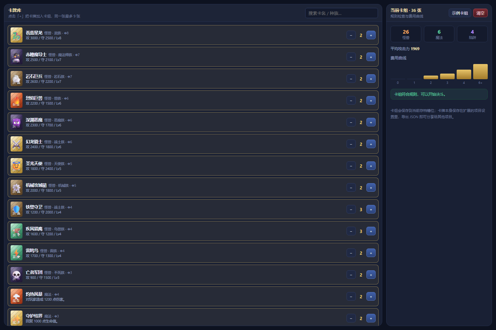
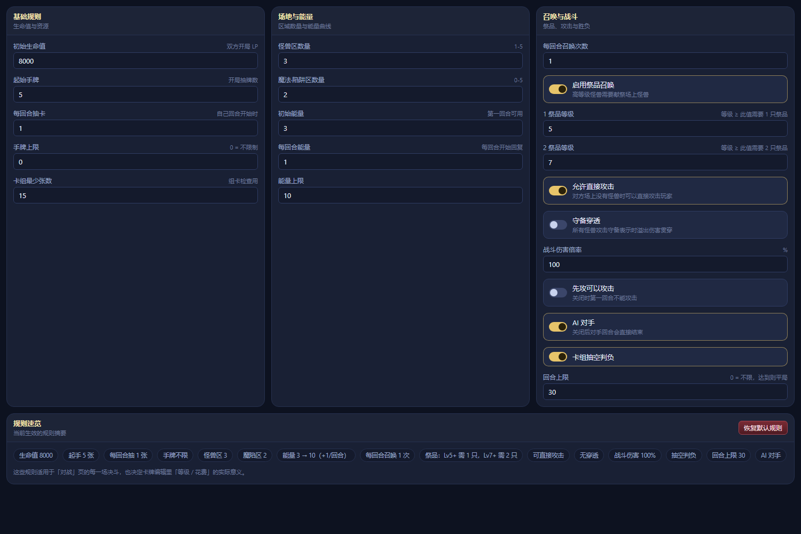
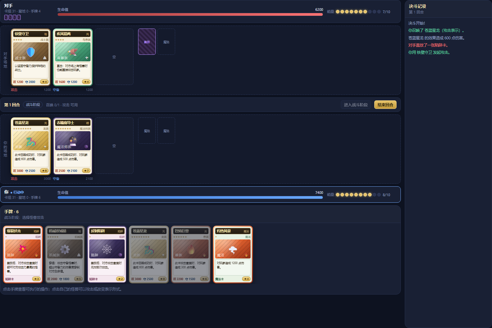
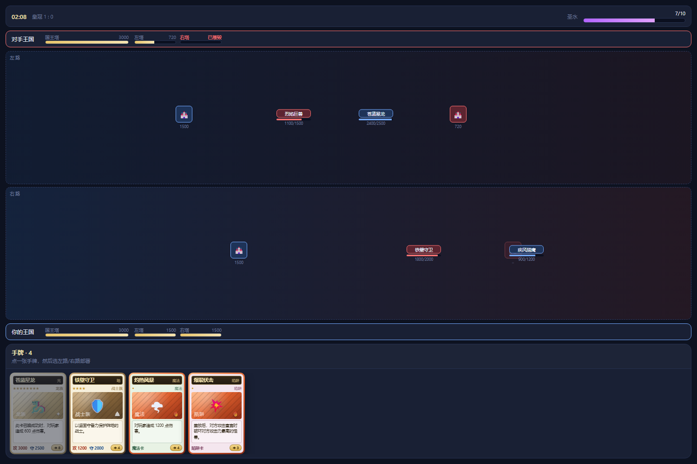
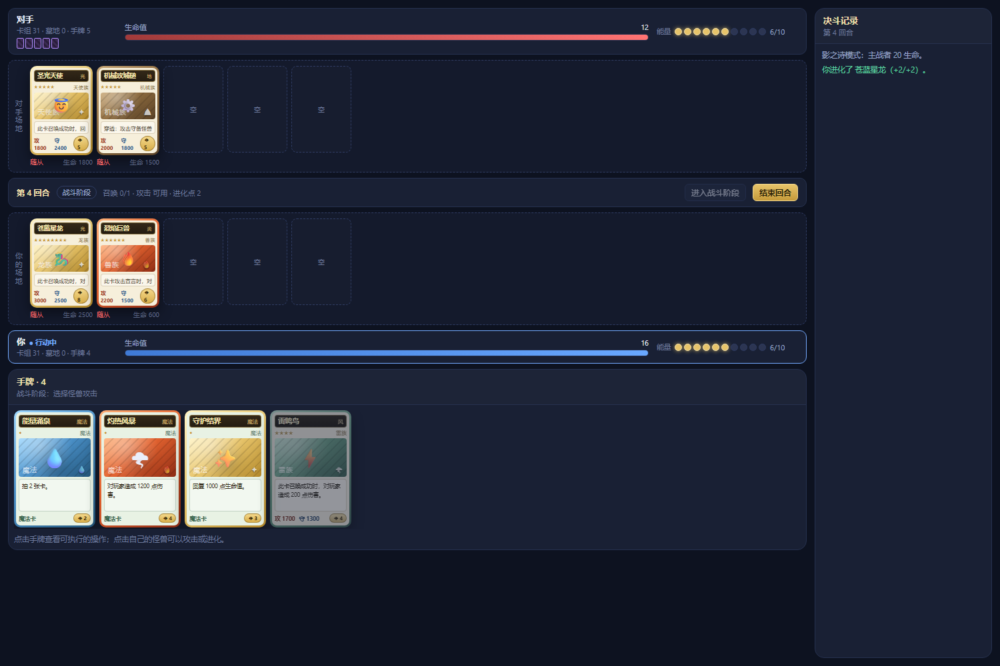
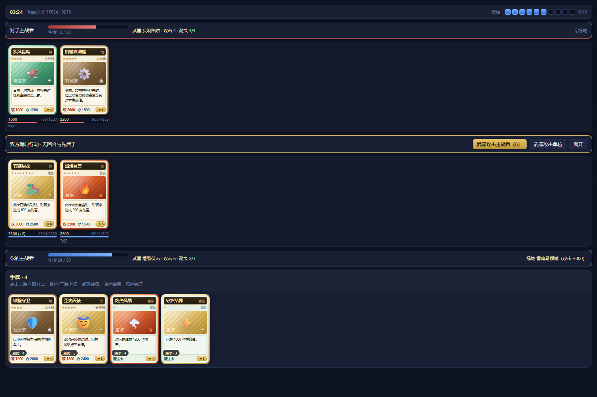

# 决斗卡牌工坊 · Duel Card Forge

**可视化自由编辑规则**的卡牌战斗扩展（LetsGal Studio / AVG Engine）。除了游戏王风的回合制，还内置**影之诗风**与**皇室战争风即时对战**两套可选规则。

> 仓库：https://github.com/chaoslmiku-maker/duel-card-forge ｜ 许可：MIT ｜ 版本：1.4.0

卡牌的**攻击力 / 守备力 / 种族 / 花费 / 卡牌效果 / 立绘 / 等级 / 属性 / 关键词**全部在面板里直接编辑，**对战规则**（生命值、抽卡、能量、场地数量、祭品召唤、穿透、直接攻击、胜负条件……）也全部可视化配置，改完立即生效。剧情里还能用 Block 实时开战、印卡、改卡、直接召唤。

| | |
| --- | --- |
| 扩展 id | `user.duel-card-forge` |
| 版本 | 1.4.0 |
| 适用 | LetsGal Studio 2.5.0（`sdkVersion: ^2.0.0`） |
| 许可 | MIT |
| 仓库 | https://github.com/chaoslmiku-maker/duel-card-forge |



| 卡组 | 规则 | 对战 |
| --- | --- | --- |
|  |  |  |

| 即时对战（皇室战争风） | 影之诗风 |
| --- | --- |
|  |  |

| 半即时（武器对战） |
| --- |
|  |

---

## 快速开始（三种方式）

**① 只想看看界面**：克隆后双击 `preview/index.html`（或用 `pnpm preview:build` 重新构建预览包），四个页签都在顶部。加后缀可直开对应页：`#deck`、`#rules`、`#battle`。

**② 装进 Studio**：把本仓库目录（含 `extension.json`）作为扩展导入 —— 个性化 → 项目设置 → 扩展树 → 导入扩展 → 选中本目录 → 勾选启用。之后任选一个入口打开面板：

1. 剧本编辑器 → 添加 Block「显示界面」→ 选 **程序界面** → **决斗卡牌工坊**；
2. 剧本编辑器 → 添加 Block「调用扩展方法」→ 选 **打开卡牌工坊**（全屏打开）；
3. 个性化 → 项目设置 → 扩展树 → 展开「程序」节点 → 预览。

**③ 从源码构建**：

```bash
pnpm install
pnpm build          # → dist/index.js 与 dist/index.mjs
pnpm test           # 引擎 101 项 + UI 14 项 + 对战 UI 9 项断言
```

---

## 四页工作流

| 页面 | 作用 |
| --- | --- |
| **卡牌库** | 新建 / 复制 / 删除卡牌，编辑全部字段，右侧实时预览卡面；支持导出 / 导入 JSON。 |
| **卡组** | 从卡牌库加卡（同卡最多 9 张），检查是否满足规则要求，显示费用曲线与平均攻击力。 |
| **规则** | 修改生命值、抽卡、能量、场地数量、召唤次数、祭品、穿透、伤害倍率、胜负条件、AI。 |
| **对战** | 用当前卡组开打：召唤、盖放、发动魔法、攻击、改变表示形式、结束回合，右侧是决斗记录。 |

---

## 卡牌字段

| 字段 | 说明 |
| --- | --- |
| 卡名 | 卡面标题。空名会自动显示为「未命名卡牌」，不会丢卡。 |
| 种类 | 怪兽 / 魔法 / 陷阱。魔法、陷阱没有攻守，靠「发动时」效果产生作用。 |
| 种族 | 自由文本，内置 18 个常见种族候选，可输入「幻神族」这类自定义种族。 |
| 属性 | 光 / 暗 / 地 / 水 / 炎 / 风 / 神，决定卡框配色与卡图渐变。 |
| 等级 | 1–12，决定卡面星数与祭品需求（阈值由规则页的「1 祭品等级 / 2 祭品等级」控制）。 |
| 攻击力 | 攻击表示的战斗力，也用于直接攻击伤害。 |
| 守备力 | 守备表示被攻击时的防御数值。 |
| 花费 | 召唤 / 发动需要支付的能量，能量曲线由规则页控制。 |
| 立绘 | 见下方「立绘写法」。 |
| 效果文本 | 卡面展示的效果说明，可自由书写。 |
| 效果规则 | 结构化效果，真正驱动结算（见下节）。 |
| 关键词 | 直击 / 穿透 / 连击 / 免疫效果伤害 / 不可被效果破坏。 |

### 立绘写法

| 写法 | 结果 |
| --- | --- |
| 留空 | 程序化卡图：属性渐变 + 种族符号 + 斜纹。 |
| `emoji:🐉` | 用 emoji 作立绘（编辑器内置 16 个快捷按钮）。 |
| `https://…` / `data:image/…` | 直接加载网络图片或内嵌图片。 |
| `assets/xxx.png` 等路径 | 交给 `ctx.asset.resolve` 解析为项目素材。 |

### 效果规则（可视化组合）

每条效果由四部分组成：

- **触发时机**：召唤成功时 / 攻击宣言时 / 被破坏时 / 发动时（魔法·陷阱）。
- **效果**：造成伤害 / 回复生命 / 抽卡 / 破坏怪兽 / 提升攻守 / 无效攻击。
- **作用目标**：对方生命值、双方生命值、自己生命值、对方最强 / 随机 / 全部怪兽、自身、自己全部怪兽。
- **数值**：伤害、回复、抽卡张数、攻守提升值；「提升攻守」还能选 攻击力/守备力 与 本回合/整场决斗。

可以给一张卡挂多条效果，逐条增删。

---

## 对战规则（规则页可改）

| 分组 | 规则 |
| --- | --- |
| 基础 | 初始生命值、起始手牌、每回合抽卡、手牌上限、卡组最少张数 |
| 场地与能量 | 怪兽区数量（1–5）、魔法陷阱区数量（0–5）、初始能量、每回合能量、能量上限 |
| 召唤与战斗 | 每回合召唤次数、祭品召唤开关、1 祭品等级、2 祭品等级、允许直接攻击、守备穿透、战斗伤害倍率、先攻可以攻击、AI 对手、卡组抽空判负、回合上限 |

默认值：8000 LP、起手 5 张、每回合抽 1、3 个怪兽区、2 个魔陷区、能量 3 起步每回合 +1（上限 10）、每回合召唤 1 次、Lv5+ 需 1 祭品、Lv7+ 需 2 祭品、允许直接攻击、无守备穿透、抽空判负、回合上限 30。

> 修改规则会立即影响下一场决斗；卡组与规则校验结果会实时显示在卡组页。

### 四种战斗模式

规则页顶部可以选择**战斗模式**，切换时会套用该模式的推荐规则（之后仍可逐项修改）：

| 模式 | 核心规则 | 界面 |
| --- | --- | --- |
| **回合制（游戏王风）** | 攻守表示、祭品召唤、攻对攻比攻击力 / 攻对守比守备力、陷阱、8000 LP | 经典决斗盘 |
| **影之诗风** | 主战者 20 生命；费用每回合 +1、上限 10；随从有生命值且伤害跨回合保留；进化点让随从 +2/+2 并解锁当回合再攻击；可以直接攻击主战者 | 影之诗面板（显示生命、进化点与进化按钮） |
| **即时对战（皇室战争风）** | 圣水随时间回复；两条兵线自动推进；每方 2 座防御塔 + 1 座国王塔，国王塔在双塔倒下后才可攻击；时间到按皇冠数、再按国王塔血量判定 | 即时战场（圣水条、兵线、塔血） |
| **半即时（武器对战）** | **没有回合与先后手**；资源按「每分钟 N 点」持续回复；单位自动作战、武器由主战者挥砍并消耗耐久；飞行越线、挡刀、战斗经验、遗效、缴械、击退；限时结束按场面评分判定 | 半即时战场（主战者血条、武器耐久、资源豆、场地槽） |

**半即时模式**是第四套独立引擎，对应「半即时 + 费用恢复 + 武器动作」的赛制：

- **卡牌定位**：卡牌编辑器新增「半即时定位」——单位 / 武器 / 法术 / 场地 / 王牌。单位与王牌上场后自动作战（王牌每方限 1）；武器装备到主战者，**攻击力=每次伤害、守备力=耐久**；法术立刻结算发动效果；场地占场地槽，用卡牌的**攻击力**作为全体友方单位的攻击加成。
- **关键词复用**：「直接攻击」= 飞行（只与飞行单位交战，否则越线直击主战者）；「不可被效果破坏」= 挡刀（必须先打它）；单位每存活 10 秒获得 +1 攻击（战斗经验，UI 显示为 `(+N)`）。
- **新增效果**：`缴械`（摧毁对方武器）与 `击退`（把对方最强单位弹回手牌）。
- **规则项**：开局资源、每分钟回复资源、资源上限、对局时长。时间到按 `主战者生命 + Σ(单位攻击×2 + 单位生命)` 计算场面评分。

即时模式与半即时模式会用到卡牌的 **移动速度 / 攻击间隔 / 攻击距离**（卡牌编辑器「战斗数值」下方）：即时模式用移动速度决定推进，半即时模式用攻击间隔决定出手频率。

卡牌字段在四种模式下的含义：

| 字段 | 回合制 | 影之诗 | 即时对战 | 半即时 |
| --- | --- | --- | --- | --- |
| 攻击力 | 战斗数值 | 造成伤害 | 每次攻击伤害 | 单位伤害 / 武器伤害 / 场地加成 |
| 守备力 | 守备时的防御 | **生命值** | **生命值** | 单位生命 / **武器耐久** |
| 花费 | 能量 | 费用（PP） | 圣水 | 资源 |
| 等级 | 祭品需求 | 仅展示 | 仅展示 | 仅展示 |

---

## 战斗结算要点

- **通常召唤**：每回合限 1 次（可改），需要支付花费并满足祭品数量；怪兽区满时不能再召唤。
- **祭品召唤**：等级达到阈值时，点击手牌 → 选择祭品（场上怪兽）→ 确认召唤，祭品进墓地。
- **表示形式**：每只怪兽每回合可改变一次；守备表示不能攻击。
- **攻击**：需先「进入战斗阶段」；对方有怪兽时选择目标，否则直接攻击玩家（受规则与「直击」关键词影响）。
- **战斗判定**：
  - 攻击表示对攻击表示：攻击力高者破坏对方，差值造成战斗伤害；相同则同归于尽。
  - 攻击守备表示：攻击力 > 守备力则破坏守备怪兽；有「穿透」或规则开启时，差值贯穿到生命值；攻击力 < 守备力时攻击方受到差值伤害。
- **陷阱**：盖放后，对方攻击宣言时自动触发，结算其「发动时」效果；「无效攻击」会直接取消该次攻击。
- **胜负**：生命值归零、卡组抽空（若规则开启）、达到回合上限（平局）。

---

## 剧本方法与项目设置

| 类型 | 名称 | 说明 |
| --- | --- | --- |
| 剧本方法 | `打开卡牌工坊` | 全屏打开面板。 |
| 剧本方法 | `重置卡组为示例` | 把当前存档卡组替换为内置示例卡组（36 张）。 |
| 剧本方法 | `读取卡牌数量` | 返回卡牌库张数，声明了 `number` 返回值，可在 If 条件里直接使用。 |
| 项目设置 | `卡牌库 JSON` | 留空 = 内置示例卡；面板编辑后自动写入，也可手动粘贴/导出。 |
| 项目设置 | `对战规则 JSON` | 留空 = 默认规则；由「规则」页编辑。 |
| 存档字段 | `deck` / `wins` / `losses` | 当前卡组与战绩，跟随存档槽位（新档默认示例卡组）。 |

**数据归属**：卡牌库与规则属于创作者内容，写在项目设置（`project.json`）；卡组与战绩属于玩家进度，写在存档（slot）。这样玩家重置存档不会丢卡，导出 JSON 也能把整套卡牌搬到别的项目。

### 剧情 Block（Block 列表分类「卡牌工坊」）

**可以在剧情里直接开战**：用「开始战斗」Block 在剧本中开一局，打完再继续剧情。这些 Block 与面板共用同一份对战状态，执行后面板会立即刷新：

| Block | 作用 | 关键参数 |
| --- | --- | --- |
| **开始战斗：在剧情中开一局** | 用玩家当前卡组（或示例卡组）开局，可指定对手卡组与先后手；自动打开面板，可等分出胜负后再继续剧情，并把结果写进变量 | 玩家卡组（当前/示例）、对手卡组（镜像/示例/自定义）、对手卡组内容、先手（玩家/对手）、自动打开面板、等待战斗结束、结果写入变量、结束后关闭面板 |
| **印卡：创建一张新卡** | 现场生成一张新卡写进卡牌库；可同时放进手牌、卡组顶，或直接召唤到玩家/对手场上 | 卡名、种类、种族、属性、等级、攻击力、守备力、花费、立绘、效果文本、关键词、追加效果（时机+类型+数值）、放入位置、表示形式、张数 |
| **加入卡牌：把卡放进手牌/卡组** | 从卡牌库取一张已有的卡塞给玩家 | 卡名、放入位置（手牌/卡组顶/卡组底）、张数 |
| **修改卡牌：改数值/文本/追加效果** | 改攻击力/守备力/花费/等级/种族/效果文本/立绘，或追加一条效果；**场上、手牌、卡组里的同名实例会同步更新** | 卡名、修改项、数值、文本、追加效果（时机+类型+数值） |
| **直接召唤：把卡召唤到场上** | 无视花费、每回合召唤次数和祭品，把一张卡直接召唤到玩家或对手场上，并触发「召唤成功时」效果 | 卡名、召唤到（玩家/对手）、表示形式 |

#### 剧情战斗怎么接

```
[对白] 对手：「来一局吧。」
[开始战斗] 玩家卡组=当前卡组
           对手卡组=自定义
           对手卡组内容=深渊恶魔*3, 烈焰巨兽*2, 灼热风暴*2
           先手=对手先攻
           自动打开面板=是  等待战斗结束=是  结果写入变量=duelResult
[设置变量] 分支判断：duelResult
  ├─ win    → [对白] 「我赢了。」
  ├─ lose   → [对白] 「这次是我输了……」
  └─ draw   → [对白] 「平局。」
```

「结果写入变量」会写进 `duelResult`（可改名），值为 `win` / `lose` / `draw`；玩家中途关掉面板则为 `aborted`，剧情不会卡死。

**指定对手卡组**有三种写法：

| 选项 | 效果 |
| --- | --- |
| 与玩家相同（镜像） | 双方用同一套牌，适合教学局 / 同门对决 |
| 内置示例卡组 | 对手用内置的 36 张示例卡组 |
| 自定义 | 按「卡名*张数」书写，逗号、分号或换行分隔；卡名支持模糊匹配，找不到会忽略并在日志提示 |

**指定先手**：

- 选「对手先攻」时，对手会**先自动打完自己的第一个回合**（召唤、盖牌；首回合同样不抽牌），然后把操作权交给玩家——玩家打开面板时已经是自己的回合，不会卡在「对手回合」。
- 先攻能不能攻击由规则页的「先攻可以攻击」控制：关闭时对手首回合只铺场、不打人；开启时对手首回合就会直接进攻。

使用提示：

- 「开始战斗」会**按规则页当前的战斗模式开局**：即时模式走即时战场，半即时模式走武器战场，回合制与影之诗走对战面板；即时与半即时模式没有先手概念，「先手」选项会被忽略。
- 等待战斗结束时脚本会**停在这一句**，直到分出胜负；这是有意设计，方便做「打完才继续」的演出。
- 「当前卡组」来自玩家在面板里组的卡组（面板打开过才有）；没打开过会退回示例卡组并在日志里说明。
- 「印卡」的立绘支持 `emoji:🐉`、图片 URL、素材路径，留空则使用属性渐变卡图。
- 「加入卡牌 / 修改卡牌 / 直接召唤」按卡名匹配卡牌库，支持模糊匹配；找不到时会在扩展日志里提示并跳过。
- 印卡/加牌/改卡/直接召唤的手牌与场面类操作需要**当前有进行中的决斗**（回合制或影之诗）；即时模式目前只能通过卡组部署单位。
- 场上怪兽区满时「直接召唤」会失败并写日志，不会中断剧情。
- 常用套路：开战前用「印卡」把专属卡塞进手牌；开战后用「修改卡牌」把 BOSS 的攻击力临时拉高；关键时刻用「直接召唤」让角色把王牌拍上场。

---

## 开发与构建

```bash
pnpm install        # 依赖：vite / typescript / react 类型（React 与 SDK 由宿主提供，不进包）
pnpm typecheck      # tsc --noEmit
pnpm test           # 引擎 101 项 + UI 14 项 + 对战 UI 9 项断言
pnpm build          # vite build → dist/index.js，并复制出 dist/index.mjs
pnpm watch          # 持续构建
pnpm preview:build  # 生成浏览器预览包 preview/dist/app.js
pnpm pack:release   # 生成 release/（运行包）与 submit/（工坊提交用源码包）
pnpm validate       # 用 Studio 自带校验器检查发布清单
```

- `dist/index.mjs` 是 `scripts/postbuild.mjs` 在构建后复制的同名产物：**扩展工坊提交前的检查固定查找 `dist/index.mjs`**，清单 `entry` 也指向它。
- `dist/` 已提交进仓库，clone 后无需构建即可导入 Studio；改源码后请重新 `pnpm build` 并一并提交。
- `sdk/` 是 Studio 的 SDK 本地副本；`sdk/extension-inspector.ts` 是为补齐类型解析新增的占位文件（Studio 2.5.0 的副本里缺这个文件，但 `sdk/index.ts` 会引用它）。Studio 重新同步 SDK 后可删除该占位文件。
- 发布到扩展工坊的物料与文案见 [PUBLISH.md](PUBLISH.md)。

### 目录结构

```
extension.json            扩展清单（id / 入口 / SDK 版本）
src/
  index.ts                扩展入口：UI 模块 + 项目设置 + 存档 + 剧本方法
  types.ts                卡牌 / 规则数据模型与归一化
  data/starter-cards.ts   内置示例卡与示例卡组
  engine/duel-engine.ts   纯函数对战引擎（召唤/战斗/效果/AI/回合/剧情注入）
  state/duel-store.ts     面板与剧情 Block 共享的对战状态
  blocks/story-blocks.ts  四个剧情 Block
  ui/                     React 界面（编辑器、卡组、规则、对战）
preview/                  浏览器预览入口（直接被 .gitignore 的是 preview/dist）
tools/                    引擎与 UI 冒烟测试脚本
scripts/                  构建后处理与打包脚本
sdk/                      Studio 提供的 SDK 副本
dist/index.mjs            构建产物（扩展清单 entry 指向它，已提交）
```

### 自测

```bash
node tools/test-engine.mjs   # 引擎：101 项断言（召唤、祭品、攻守判定、穿透、陷阱、胜负、AI、剧情注入）
node tools/ssr-check.mjs     # UI：14 项断言（扩展类、settings、卡牌库渲染）
node tools/ssr-battle.mjs    # UI：9 项断言（对战界面与开始界面渲染）
node tools/validate-release.mjs  # 用 Studio 自带校验器检查发布清单
```

这些脚本用 TypeScript 自带 transpile 把源码转成 ESM 后运行，不依赖额外测试框架。

---

## 已知限制

- 对战过程保存在面板与共享 store 的内存中，刷新预览或关闭再开需要重新开局（卡组与战绩会保存）。
- 效果系统是「触发 × 效果 × 目标 × 数值」的组合，暂不支持条件判断、连锁与多段选择。
- AI 是启发式策略：优先高攻召唤、能打就打、打不过就跳过，不会做复杂换牌。
- 卡牌编辑每次改动都会写入项目设置，卡牌很多时（上百张）建议用导出/导入 JSON 维护。
- 玩家端（Player）的项目设置只存在内存里，剧情印的卡重启后不保留；「剧情专属卡」建议每次进剧情时重新印。

---

## 许可

[MIT](LICENSE)。卡牌示例文本与图标均为本项目原创，不包含任何第三方作品的素材。
